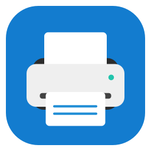
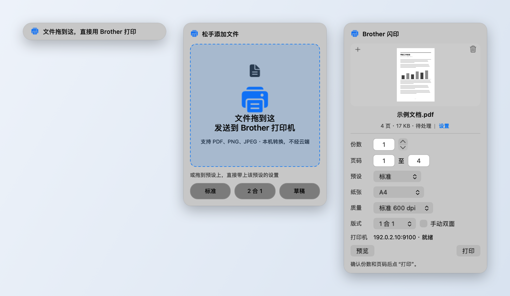
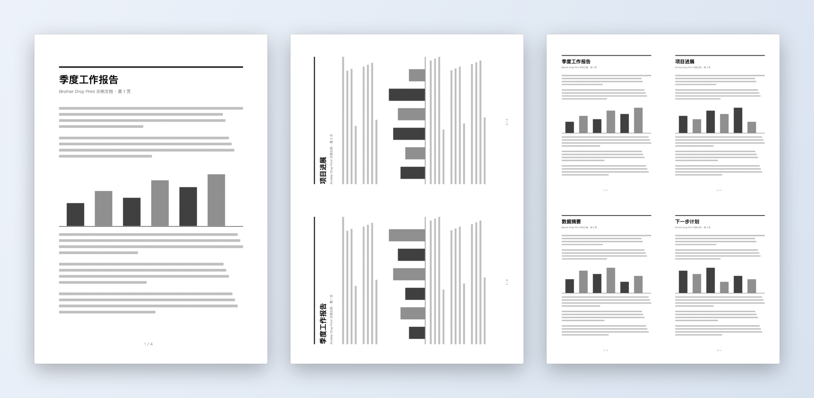
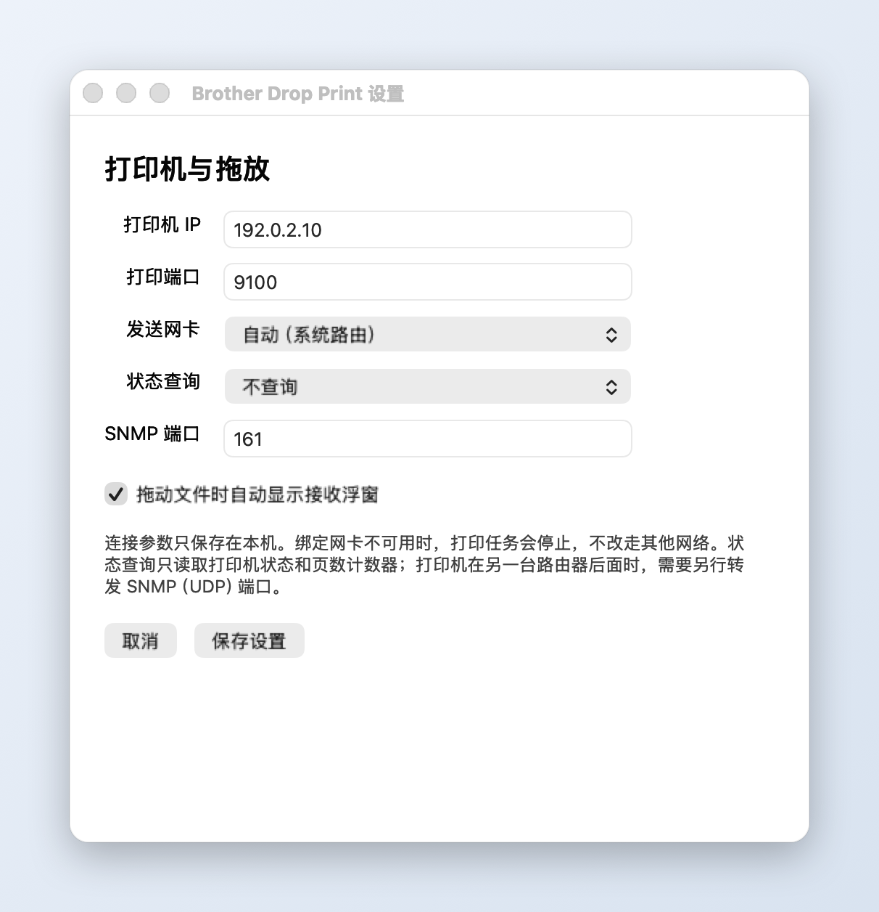

<p align="center">
  
</p>

<h1 align="center">Brother Drop Print</h1>

<p align="center">
  像在 QQ 里传文件一样：把 PDF、图片或办公文档拖到浮窗上，直接发送到 Brother 激光打印机。<br>
  不装驱动，不需要管理员权限，文件只在本机转换。
</p>

<p align="center">
  A native macOS app with a QQ-style drag receiver that prints straight to Brother lasers over TCP 9100.<br>
  Experimental interoperability project; not affiliated with Brother.
</p>

<picture>
  <source media="(prefers-color-scheme: dark)" srcset="docs/images/flash-dark.png">
  
</picture>

## 拖放浮窗

从 Finder 或其他 App 拖动文件时，浮窗自动出现，全程不抢焦点，不打断你正在用的 App。

| 阶段 | 发生什么 |
| --- | --- |
| 开始拖动 | 菜单栏打印机图标下方出现提示胶囊，文字轮流提示可以拖到这里打印。 |
| 拖到胶囊上 | 原地展开为“松手添加文件”卡片。拖到下方的预设上，可直接带上“2 合 1”“草稿”等设置。不支持的文件会让卡片变红。 |
| 松手 | 卡片变成打印面板：可翻页缩略图、份数、页码、预设、纸张、质量、版式。点“打印”发送，点“查看完整内容”打开可连续滚动的工作台。点浮窗外或按 Esc 关闭，文件仍留在工作台列表中。 |

全局检测只看鼠标手势和拖拽剪贴板的类型变化，不监视键盘，也不读取普通剪贴板。
不需要时，可在设置里关闭自动浮窗。

## 打印选项



<sub>上图直接由打印栅格渲染：同一份 4 页文档，分别按 1 合 1、2 合 1、4 合 1 输出。</sub>

- **纸张**：A4、A5、A6、B5、Letter、Legal、Executive；另可选纸张类型（普通纸、薄纸、厚纸、信封等）。
- **质量**：标准 600 dpi、草稿 300 dpi、省墨；碳粉浓度 −6 至 +6。
- **版式**：2、4、9、16 合 1，四种排列顺序。2 合 1 会把两页横排在一张纸上。
- **手动双面**：先印正面，App 提示如何翻面放回纸盒，确认后再印背面；页数为奇数时会自动补空白页。
- **预设**：内置标准、2 合 1、草稿、省墨、手动双面；可在工作台把当前设置存为自己的预设。前三个会出现在浮窗卡片上。
- **页码与份数**：页码范围，1–99 份；多份时按整份文档顺序输出。
- **文件**：多页 PDF、PNG、JPEG，以及 Word（DOC/DOCX/ODT/RTF）、Excel（XLS/XLSX/XLSM/ODS/CSV/TSV）、PowerPoint（PPT/PPTX/ODP）和 TXT。办公文档通过本机 LibreOffice 转成临时 PDF，原始文件不会被移动或修改。应用内置 Noto 简体中文字体，并自动替代文档中的宋体、微软雅黑、黑体、仿宋和楷体，避免缺字变方框。
- **批次**：工作台可以预览、管理多文件列表，按顺序发送；发送过程中新加入的文件留到下一批。

## 打印机状态与出纸确认

- 自动通过 SNMP，或通过打印端口 9100 上的 PJL 查询，读取就绪、休眠、缺纸、卡纸、机盖打开、面板文字和页数计数器；SNMP 可用时还能读碳粉余量。
- 发送后轮询页数计数器，按发送顺序把文件标为“已出纸”；超时会提醒你到打印机旁检查。
- 查询都是只读的，失败只显示“状态未知”，不影响打印。
- 在只开放 9100 端口的 DCP-1618W 上，PJL 状态和页数查询已经实测可用。

## 设置

<picture>
  <source media="(prefers-color-scheme: dark)" srcset="docs/images/settings-dark.png">
  
</picture>

- 手动填写打印机（或转发入口）的 IPv4 地址和端口，通常是 9100。不依赖设备搜索，也不要求在同一个 Wi-Fi 下。
- 可以把发送连接绑定到指定的有线网卡或 Wi-Fi；绑定的网卡断开时打印会停止，不会改走其他网络。
- 所有连接参数只保存在本机偏好设置里，不写进源码或安装包。

## 安装与使用

需要 macOS 14 或更新版本，以及 Xcode Command Line Tools。打印办公文档还需要安装 [LibreOffice](https://www.libreoffice.org/download/download-libreoffice/)；只打印 PDF 和图片时不需要。

```bash
bash scripts/build.sh
```

如果需要启动后只常驻菜单栏、不显示 Dock 图标，也不自动打开工作台，可构建后台版：

```bash
bash scripts/build-background.sh
```

后台版生成在 `build/Brother Drop Print Background.app`。点击菜单栏打印机图标可随时打开工作台；关闭工作台后，文件转换、打印发送和拖放接收仍继续运行。普通版和后台版使用独立设置，请只运行其中一个，避免同一个文件被两个实例同时接收。

1. 打开生成的 `build/Brother Drop Print.app`。
2. 在“设置…”中填写打印机地址和端口。
3. 先在工作台点“准备校准页”打一页，检查边框、方向、灰阶和 100 mm 标尺。
4. 之后把文件拖到自动出现的浮窗、工作台、菜单栏图标或 Dock 图标上即可；也可以点“添加文件”。

关闭工作台不会退出 App，所以仍能接收之后的拖动；要退出请用 App 菜单。

开发构建只有本地 ad-hoc 签名，没有 Developer ID 签名或 Apple 公证。

### 网络与安全

- 如果打印机在另一台路由器后面，地址填已经配置了打印端口转发的入口地址。只转发网页端口无法打印。
- 本 App 不发送搜索广播，也不会修改路由器配置。
- RAW / 9100 通常没有加密和登录认证，请只在受控网络中使用，并按需限制转发来源。
- TCP 发送完成只表示数据已经交给打印机，不代表已经出纸；发送失败时不会自动重试，以免重复打印。

## 当前状态

这是实验性实现，在 macOS 26 / Apple silicon 上配合 DCP-1618W 开发。

| 功能 | 状态 |
| --- | --- |
| A4 标准 600 dpi 出纸 | 实机确认 |
| Finder 拖动唤出浮窗、不抢焦点、投递到打印面板 | 实机确认 |
| PJL 状态与页数查询（只开放 9100 时） | 实机确认 |
| 其他纸张和质量组合 | 离线测试通过，待实机出纸 |
| 打印后用页数计数器确认出纸 | 离线测试通过，待实机验证 |
| 手动双面的翻面方向 | 离线测试通过，待实机验证 |
| 其他 App 的延迟文件、多显示器、全屏空间 | 待验收 |

编码核心来自维护中的 brlaser，几何参数沿用其 DCP-1600 / DCP-1610W 配置；不能据此推断所有 Brother 型号都兼容。
逐项实测清单见 [打印参数规格](docs/brother-print-spec.md) 第 6 节。

## 工作原理

```
Word / Excel / PowerPoint ──LibreOffice──▶ 临时 PDF ┐
PDF / PNG / JPEG ──────────────────────────────────┴─CoreGraphics──▶ 黑白栅格 ──brlaser──▶ TCP 9100
                  （本机排版、多合一）                 （本机编码）
```

开发时用 REA 静态检查了 Brother 官方安装器里的 `ADKCore.dll`：

- 设备搜索和打印发送是两条独立路径：搜索用 UDP 161 / SNMP，打印用 TCP 9100。这解释了“端口能连上，但安装器搜不到设备”的情况。
- 其 `BrMode1030PCL` / `BrMode1030Compression` 路径使用 PJL 作业包装、PCL 1030 光栅模式和替换 / 重复行压缩，与 brlaser 的格式对应。
- 纸张代码、逐份规则、草稿分辨率、多合一网格、PJL 与 SNMP 状态查询等参数语义都整理在 [打印参数规格](docs/brother-print-spec.md) 中，并附证据 ID。

拖放浮窗参考了 QQ 和向日葵的原生拖放机制（全局鼠标监视加拖拽剪贴板变化检测），以及 QQ 浮窗的录屏。
界面和状态机都是独立编写的，记录见 [架构与研究记录](docs/architecture-v1.1.md)。

本项目没有复制或分发官方程序集、安装包、反编译代码、账号或网络配置；原始分析记录只保存在被 Git 忽略的本机 `evidence/` 目录。
上游代码的版本和授权说明见 [THIRD_PARTY.md](THIRD_PARTY.md)。

## 开发

| 位置 | 内容 |
| --- | --- |
| `Sources/` | App 界面、拖放浮窗、渲染、打印队列、状态查询和 TCP 传输 |
| `native/Encoder.cpp` | PBM 栅格到打印数据的适配器 |
| `vendor/brlaser/` | 上游编码核心，保持原样 |
| `Tests/` | 离线检查：渲染、编码、回环 TCP / SNMP / PJL、批次与双面流程 |
| `docs/` | 架构记录、打印参数规格和 README 图片 |

```bash
bash scripts/test.sh
```

不需要安装 CUPS 开发库、Ghostscript 或旧版 Brother 驱动。构建只针对当前机器的架构；GitHub Actions 会运行同样的构建和离线检查，并保存开发构建 ZIP。

其他辅助脚本：

- `scripts/make-screenshots.sh`：用 App 自己的界面和打印栅格重新生成 `docs/images` 里的截图，只使用示例地址和生成的示例文档。
- `scripts/build-ui-fixture.sh`：生成本机 UI 验证用的拖动源 App；它只拖动合成的测试 PDF，不会打印，也不连接远程服务。

## 许可证

GPL-2.0-or-later，详见 [LICENSE](LICENSE)。Brother 名称和商标归其权利人所有。
